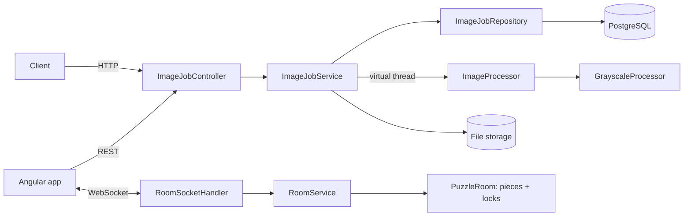

# Image Job Service


A full-stack web app that turns a photo into a jigsaw puzzle you can solve in the browser, alone or live with friends. A Spring Boot service accepts image uploads, processes them asynchronously in the background, and tracks each job's state in PostgreSQL; an Angular frontend lets players drag the pieces into place.

Uploading returns immediately with a job ID. Processing runs on Java 21 virtual threads, and clients poll the job's status and download the result when it's done. This is the same asynchronous job-queue pattern used for video transcoding, report generation, or model inference, with grayscale conversion as the current processing step.

## Features

- Upload an image and get a job ID back immediately
- Background processing on virtual threads, with job states `PENDING → RUNNING → DONE / FAILED`
- Error handling: unsupported files end as `FAILED` with an error message
- Pluggable processing through an `ImageProcessor` interface
- Unit tests with JUnit 5, AssertJ and Mockito
- CI with GitHub Actions, running the tests against a real PostgreSQL service
- One-command setup with Docker Compose
- Limit on concurrently running jobs, and optimistic locking on job updates
- Jigsaw puzzle generation: pieces with interlocking tabs, cut in parallel
- Angular frontend with a drag-and-drop puzzle board and snapping
- **Multiplayer:** share a room code and solve the same puzzle live over WebSockets, with a lock on every piece

## Architecture



The controller handles HTTP, the service holds the business logic, and the repository handles persistence. The service depends on the `ImageProcessor` interface rather than a concrete implementation, so new processing backends can be added without changing it.

## Multiplayer

One player clicks **Play with friends** and gets a short room code (for example `K7PX2`) and a link to share. Everyone in the room sees the same pieces and every move live.

- **The server is the single source of truth.** Browsers only ask to grab, move or drop a piece; the server decides and sends the result to everyone. It also decides whether a dropped piece snaps into place.
- **Every piece has a lock.** Grabbing a piece asks the server for its lock. All actions in a room are handled one at a time, so when two players grab the same piece at the same moment, the first request wins and the other player's drag is cancelled.
- **Locks expire.** A lock is a lease of 5 seconds that is renewed while the piece is held. If a player closes the tab or loses the connection, the lock is released, so a piece can never stay stuck.
- **Messages arrive in the same order for everyone,** because each change is sent to all players while the room is still locked.

Rooms live in memory: they end on a server restart and are removed after 10 minutes without players.

## Tech stack

Java 21 · Spring Boot · Spring WebSocket · Spring Data JPA / Hibernate · PostgreSQL · Angular · JUnit 5 · Mockito · Vitest · Docker · nginx · GitHub Actions

## Getting started

Requirements: Docker.

```bash
git clone https://github.com/lornalelcaj/image-job-service.git
cd image-job-service
docker compose up --build
```

The app is then available at `http://localhost`.

## API

| Method | Endpoint | Description |
|---|---|---|
| `POST` | `/jobs` | Upload an image (multipart field `file`), returns the new job |
| `GET` | `/jobs` | List all jobs |
| `GET` | `/jobs/{id}` | Get a job's status |
| `GET` | `/jobs/{id}/result` | Download the processed PNG (`409` if not finished) |
| `POST` | `/jobs/{id}/cancel` | Cancel a pending or running job (`409` if already finished) |
| `POST` | `/jobs` | … optional fields: `type=PUZZLE`, `rows`, `cols`, `seed` |
| `GET` | `/jobs/{id}/pieces` | List puzzle pieces with their positions and image URLs |
| `GET` | `/jobs/{id}/pieces/{row}/{col}` | Download one piece as a transparent PNG |
| `POST` | `/rooms` | Open a multiplayer room for a finished puzzle (`{"jobId": 1}`), returns its code |
| `GET` | `/rooms/{code}` | Look up a room |
| `WS` | `/ws/rooms?room={code}` | Live connection to a room (messages: `GRAB`, `MOVE`, `DROP` → `STATE`, `PLAYERS`, `LOCKED`, `MOVED`, `RELEASED`) |

Example:

```bash
curl -F "file=@photo.jpg" http://localhost:8080/jobs
# {"id":1,"filename":"photo.jpg","status":"PENDING", ...}

curl http://localhost:8080/jobs/1
# {"id":1,"filename":"photo.jpg","status":"DONE", ...}

curl -o result.png http://localhost:8080/jobs/1/result
```

## Running the tests

The unit tests need nothing extra. The Spring startup test needs PostgreSQL on `localhost:5432`:

```bash
docker run --name imagejobs-db -e POSTGRES_USER=imagejobs -e POSTGRES_PASSWORD=imagejobs \
  -e POSTGRES_DB=imagejobs -p 5432:5432 -d postgres:16
./mvnw test
```

## Roadmap

- Store multiplayer rooms in the database, so games survive a server restart
- Player names and a shared timer in multiplayer games
- Object storage (e.g. S3) for images, so the service can run on several servers
- CUDA-based processing backend, benchmarked against the CPU implementation
